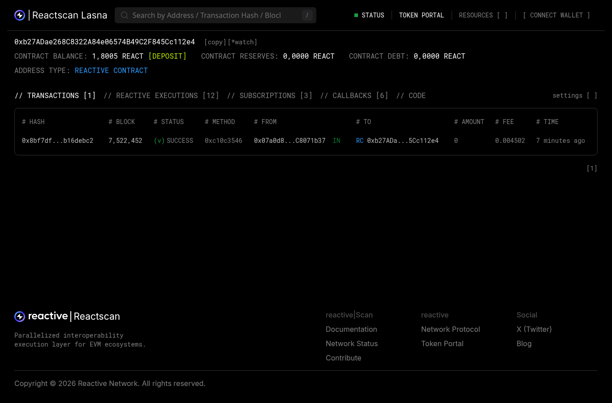
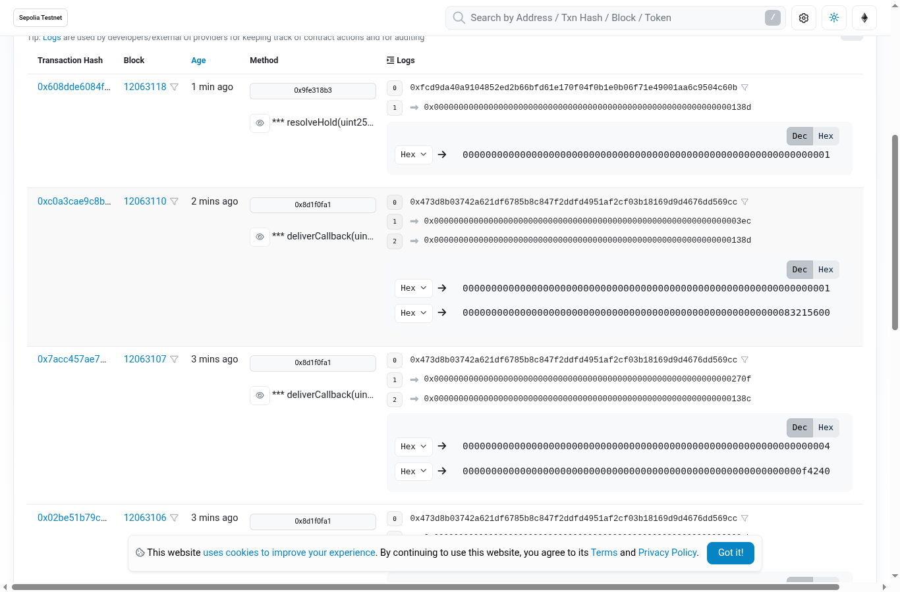
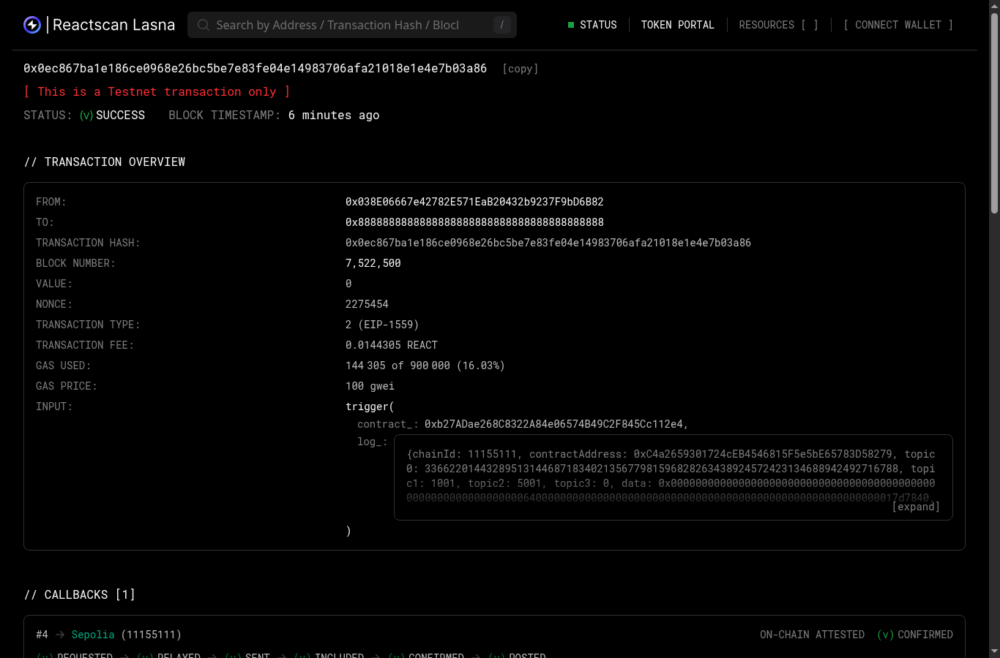
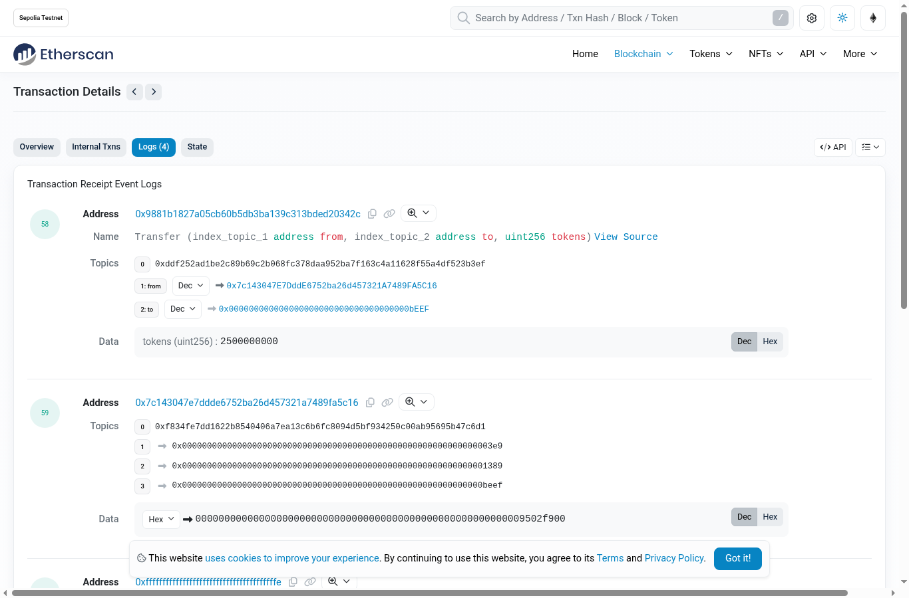

# Reactive AP Autopay: a three-way match that pays on its own

**Reactive Omni Buildathon · Track: Set It and Forget It**

I'm a CFO. The control I trust most in accounts payable is the **three-way match**. A vendor gets paid only when the purchase order, the goods receipt and the invoice agree. In most companies that control is a person and a spreadsheet, so it runs late, gets skipped at month-end, or leaks duplicates.

This project turns the control into on-chain infrastructure that runs by itself:

- **Origin (Ethereum Sepolia):** `APLedger` emits `POCreated`, `GoodsReceived` and `InvoiceSubmitted`. It does no validation on purpose, so bad invoices still reach the control.
- **Reactive Network (Lasna):** `APMatchReactive` subscribes to all three events. It keeps per-PO state for ordered, received and already-approved quantities, and decides each invoice:
  - `PAY`: price within tolerance (2% here) and quantity covered by goods received but not yet invoiced
  - `HOLD_PRICE`: unit price above the PO by more than the tolerance
  - `HOLD_QTY`: billing for more than was received (covers early or over-billing and partial deliveries)
  - `BLOCK_DUPLICATE`: the invoice ID was already processed
  - `HOLD_NO_PO`: no purchase order behind the invoice
- **Destination (Ethereum Sepolia):** the Reactive callback proxy calls `APEscrow.settle(...)`. The escrow pays the vendor in the settlement token on `PAY`, parks holds for a human, and records blocked duplicates. Paying an invoice that's covered but underfunded becomes a hold, never an overdraft.

Nobody runs a keeper, cron or bot. Once the escrow and reactive contract are funded, every invoice that ever hits the ledger is matched and settled or held.

```
Sepolia APLedger ──events──▶ Lasna APMatchReactive.react() ──requestCallbackV_1_0──▶ Sepolia APEscrow.settle()
  POCreated                    per-PO state + match rules                        pay vendor / hold / block
  GoodsReceived                                                                  CFO: resolveHold(release|reject)
  InvoiceSubmitted
```

## Controls built in
- `APEscrow.settle` is guarded twice: `onlyServiceProvider`, so only the Reactive callback proxy can call it, and `onlyCallbackSender(rvm)`, so the call must originate from *our* reactive contract.
- `react()` is `onlySystem`, and it also rejects logs from any chain or contract other than the configured ledger.
- Separation of duties: only the buyer can raise POs and receipts. Invoices come from the PO's vendor (or AP keying on the vendor's behalf).
- Human-in-the-loop: held invoices wait for `resolveHold(invoiceId, release)` from the escrow owner (the CFO). Duplicates can't be released.

## On-chain proof (Lasna testnet + Sepolia)
Full table of contract addresses and tx hashes for each origin → reactive → callback loop: **[PROOF.md](PROOF.md)**.

| | |
|---|---|
| APLedger (Sepolia) | `0xC4a2659301724cEB4546815F5e5bE65783D58279` |
| APMatchReactive (Lasna) | `0xb27ADae268C8322A84e06574B49C2F845Cc112e4` |
| APEscrow (Sepolia) | `0x7c143047E7DddE6752ba26d457321A7489FA5C16` |
| MockUSD (Sepolia, testnet only) | `0x9881b1827A05cB60B5Db3Ba139c313bDeD20342c` |

Results: 1 invoice paid automatically, 1 duplicate blocked, 1 price hold (released by the CFO afterwards), 1 quantity hold, and 2 no-PO holds. Reactscan shows 3 subscriptions, 12 reactive executions and 6 callbacks.






## Run it
```bash
forge build && forge test          # 16 tests incl. a fuzz test: never pays above received qty
# fire a cycle against the deployed contracts (needs a funded Sepolia key file)
KEY_FILE=~/.reactive/deployer.key ./script/demo.sh 2001 6001 10 5000000          # pays
KEY_FILE=~/.reactive/deployer.key ./script/demo.sh 2002 6002 10 5000000 10 6000000   # price hold
```

### Deploy your own
1. Sepolia: `forge create src/MockUSD.sol:MockUSD`, then `forge create src/APLedger.sol:APLedger`
2. Lasna: `forge create src/APMatchReactive.sol:APMatchReactive --value 2ether --constructor-args 11155111 <ledger> 11155111 200`
3. Sepolia: `forge create src/APEscrow.sol:APEscrow --value 0.03ether --constructor-args 0xAa14d9Cd0f788Ca23d11805986C1d8bd035D23b4 <reactive> <token>`
4. Lasna: `cast send <reactive> "setEscrow(address)" <escrow>`. Then fund the escrow with the settlement token.

Built on [reactive-lib-omni](https://github.com/Reactive-Network/reactive-lib-omni) (Solidity 0.8.29, `SYSTEM.requestCallbackV_1_0`).

## Honest limits
- Testnet only (Sepolia + Lasna). The settlement token is a mock with no value, and the vendor is a placeholder address.
- PO and invoice data are plain numbers on a public chain. A real deployment would put hashes or IDs on-chain and keep commercial terms private.
- One price tolerance for all POs, and no tax, freight or currency handling.
- Single ledger and single escrow. Multi-entity and multi-chain settlement is the obvious next step.

## License
MIT
